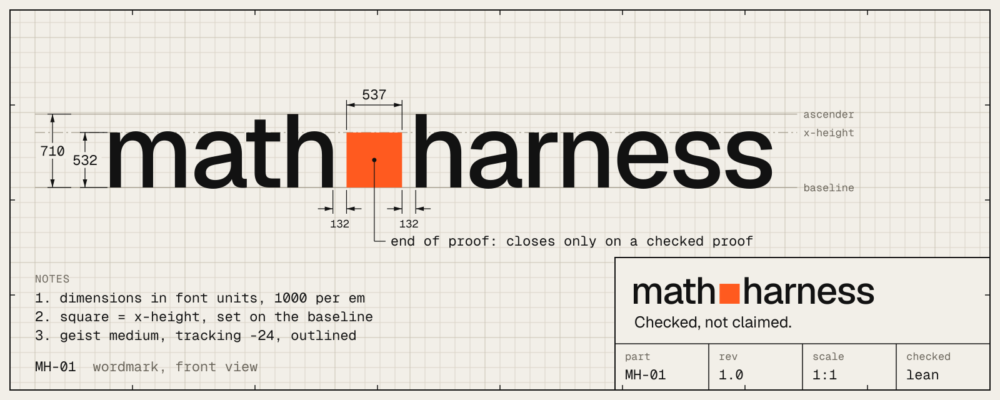
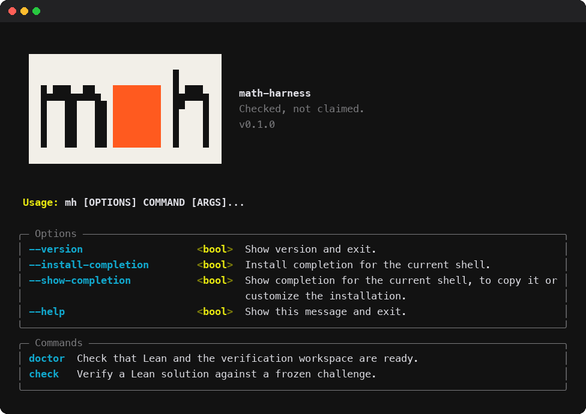
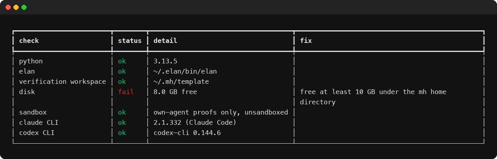
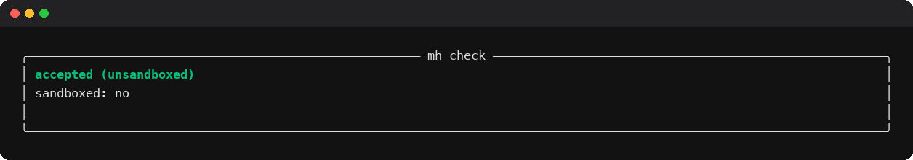

<picture>
  <source media="(prefers-color-scheme: dark)" srcset="docs/brand/banner-dark.svg">
  
</picture>

<p align="center">
  <a href="LICENSE"></a>
  
  
  
  
</p>

<p align="center">
  <a href="#quickstart"></a>
  &nbsp;
  <a href="#how-it-works"></a>
</p>

**math-harness** runs AI agents on open math problems and only accepts proofs that pass Lean's official `lake comparator`. Today it is the verification core: give it a frozen challenge statement and a solution, and you get a clear accepted or rejected answer, with an optional JSON receipt. The command is `math-harness`, and `mh` is a short alias.

<p align="center">
  
</p>

## What it is and is not

It checks that a Lean solution proves exactly the theorem in the challenge file, using the official comparator, and it writes an optional JSON receipt of the run.

It never claims a problem is "solved". Today `mh check` says accepted or rejected. The strongest status planned later is "verified candidate". It never posts or submits anything for you. And Lean-verified does not mean new or significant: a proof can be correct and already known, or about a statement that does not matter.

## Quickstart

Not on PyPI yet. From a git clone:

```
uv tool install .
```

Then let the tool set up Lean:

```
mh doctor --fix
```

<p align="center">
  
</p>

`doctor` reports what is missing. With `--fix` it asks for confirmation, then installs `elan`, a pinned Lean toolchain, and prepares the verification workspace. The first run takes a while because it downloads Mathlib.

Everything `mh` keeps lives in `~/.mh`, set `MH_HOME` to put it somewhere else. The verification workspace there takes about 8 GB, mostly Mathlib, so `doctor` asks for at least 10 GB free.

Check a proof:

```
mh check --challenge Challenge.lean --solution Solution.lean --theorem my_theorem --origin own
```

<p align="center">
  
</p>

Options:

- `--theorem NAME`, repeatable, the theorems to compare.
- `--origin own|untrusted`, where the solution came from. Default is `untrusted`.
- `--receipt PATH`, write a basic JSON receipt: hashes of both files, toolchain, command and verdict.
- `--json`, print the verdict as JSON.
- `--keep-check-dir`, keep the directory the check ran in and print its path, for debugging.

Exit codes: 0 accepted, 1 rejected, 2 could not start (missing toolchain, bad input, sandbox unavailable) or the receipt could not be written. The verdict is always printed before the receipt is written.

## How it works

Each check runs in a fresh directory under `~/.mh/runs`, so nothing from a previous run can leak in. `lake comparator` then runs these steps in order, and the proof is accepted only if every one passes:

1. resolve dependencies (the pinned Mathlib),
2. build and export the challenge,
3. build and export the solution,
4. compare the two statements at the kernel level,
5. check that only `propext`, `Classical.choice` and `Quot.sound` are used,
6. replay the proof in the Lean kernel.

Each check rebuilds every module the files import, so its cost grows with the imports. A file that imports one narrow module takes minutes, and `import Mathlib` takes much longer. Faster checks through Lake's artifact cache are on the roadmap.

## Sandbox caveat

Untrusted proofs are run inside a bubblewrap sandbox, which is Linux-only. On macOS only `--origin own` works, and it runs unsandboxed, so a passing check says `accepted (unsandboxed)`. Do not check untrusted input on macOS. Use Linux, or wait for container support, which is on the roadmap.

## Roadmap

1. Verification core: `doctor`, `check` and a basic `--receipt` (this release).
2. Catalogue of problems to attempt.
3. Agents and a solve loop driven by your own `claude` CLI, with an interactive `mh` prompt to launch and follow runs.
4. Trust outputs: fuller receipts and reports, and container-based sandboxing for untrusted input on macOS.

Design notes are in `docs/superpowers/specs/2026-11-26-math-harness-design.md`. Regenerate the screenshots with `scripts/screenshots.sh` and the terminal logo with `scripts/gen_logo.py`.

## License

Apache-2.0.
